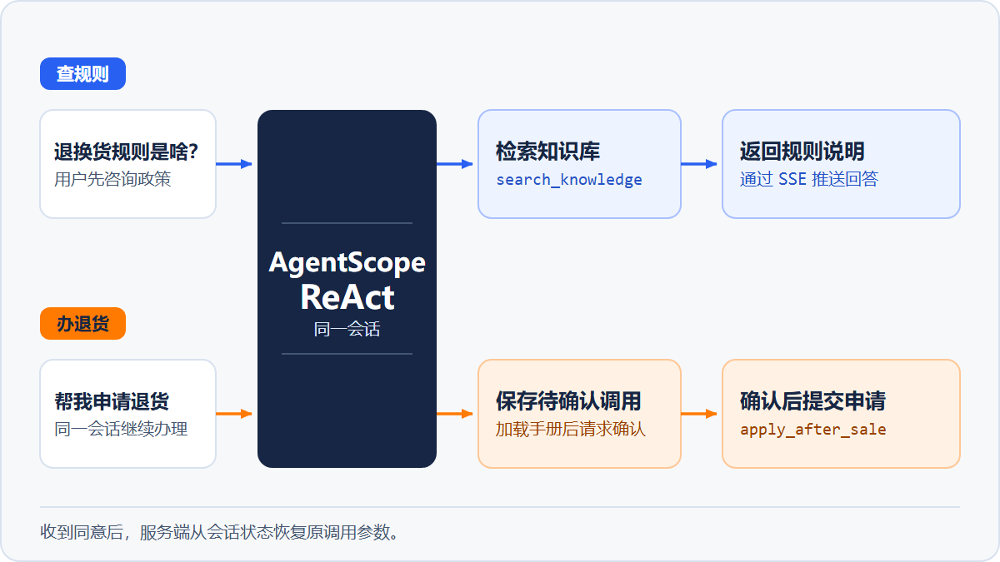

# Ragent · Java AgentScope 知识库助手

**问退换规则可以直接答，申请退货要先确认。**

基于开源 Ragent 的 Java 实践。用 AgentScope ReAct 串起知识库问答、按需加载的 Skills 和 MCP 工具调用。一个会话可以从咨询转到办理，写操作经用户确认后才继续。

[Agent 装配](agent/src/main/java/com/nageoffer/ai/ragent/agent/config/ReActAgentProvider.java)　[退换货手册](resources/initializer/bit-selection/skills/after-sale-apply.md)　[确认入口](agent/src/main/java/com/nageoffer/ai/ragent/agent/controller/AgentChatController.java)　[验证用例](#验证入口)

## 同一个会话里的两个请求

1. **「退换货规则是什么？」** Agent 可以调用 `search_knowledge` 查知识库，把规则通过 SSE 返回。示例手册明确区分了政策咨询与售后办理。[知识库工具](agent/src/main/java/com/nageoffer/ai/ragent/agent/tool/KnowledgeSearchTool.java)
2. **「那帮我申请退货。」** Agent 加载退换货手册，核对订单和商品，再准备 `apply_after_sale` 调用。用户同意后，Java 从保存的会话状态取回原调用并继续。售后单是否创建，由 MCP 工具的返回结果决定。[技能绑定](resources/initializer/bit-selection/skills/010-after-sale-apply.properties) · [确认逻辑](agent/src/main/java/com/nageoffer/ai/ragent/agent/service/impl/AgentChatServiceImpl.java) · [售后工具](mcp-server/src/main/java/com/nageoffer/ai/ragent/mcp/executor/bit/BitAfterSaleApplyMcpExecutor.java)

上面是按仓库中的售后示例梳理的源码链路。

## 三个关键实现

- **模型什么时候能看到写工具？** `load_skill` 按需加载手册后，推理阶段才暴露绑定的工具。工具执行前再校验一次。手册被上下文压缩移走后，相关工具随之收回。[工具可见性](agent/src/main/java/com/nageoffer/ai/ragent/agent/skill/AgentSkillMaskingMiddleware.java) · [执行校验](agent/src/main/java/com/nageoffer/ai/ragent/agent/tool/McpToolProxy.java)
- **确认时的调用参数从哪来？** 前端提交会话、消息标识和同意或拒绝。服务端从 PostgreSQL 持久化的 Agent 状态取回待确认调用，按原参数交还 AgentScope 处理。[确认入口](agent/src/main/java/com/nageoffer/ai/ragent/agent/controller/AgentChatController.java) · [状态存储](agent/src/main/java/com/nageoffer/ai/ragent/agent/state/PgAgentStateStore.java)
- **长对话和断连怎么收尾？** 分级裁剪历史工具结果并摘要旧对话，保持调用与结果配对。SSE 停止时通过 Redis 传播取消信号，会话互斥约束重复启动。[上下文压缩](agent/src/main/java/com/nageoffer/ai/ragent/agent/memory/AgentContextCompactor.java) · [流式任务控制](framework/src/main/java/com/nageoffer/ai/ragent/framework/web/StreamTaskManager.java)

## 验证入口

- [AgentScope 技能加载测试](agent/src/test/java/com/nageoffer/ai/ragent/agent/skill/AgentScopeSkillActivationLifecycleTest.java)和[上下文裁剪测试](agent/src/test/java/com/nageoffer/ai/ragent/agent/memory/AgentContextTrimmerTest.java)对应工具开放与消息裁剪行为。
- [流式事件测试](agent/src/test/java/com/nageoffer/ai/ragent/agent/service/handler/AgentStreamEventBridgeTest.java)和[任务收尾测试](agent/src/test/java/com/nageoffer/ai/ragent/agent/service/handler/AgentRunHandleTest.java)对应增量与终止流程。

技术栈为 Java 17、Spring Boot、AgentScope Java、PostgreSQL / pgvector、Redis / Redisson。流程图提供 [SVG 源文件](assets/agent-ask-to-act.svg)。

## 上游与许可

本仓库基于开源 [nageoffer/ragent](https://github.com/nageoffer/ragent)。此 README 为 Java AgentScope 实现的展示说明，保留上游版权声明和 [Apache License 2.0](LICENSE)。
