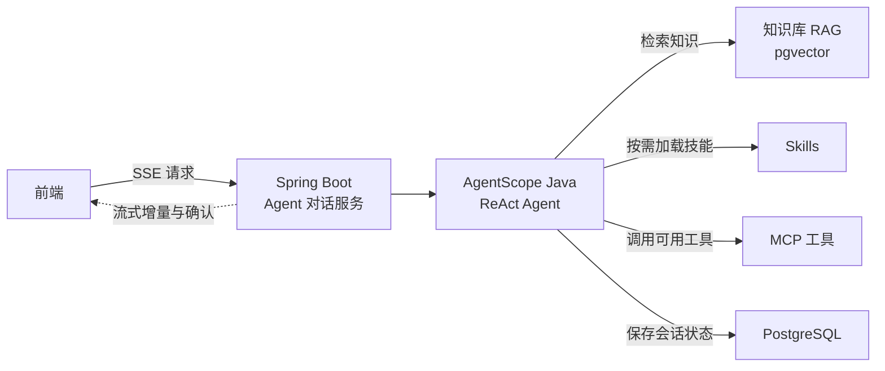

# Ragent · Java AgentScope 知识库助手

**面向企业知识问答的 Agentic RAG 项目**

基于开源 Ragent，用 Java AgentScope ReAct 把知识库检索、Skills 和 MCP 工具串到同一个对话里。用户可以连续追问，多步任务中需要确认的操作会暂停，收到决定后再继续。

[ReAct 装配](agent/src/main/java/com/nageoffer/ai/ragent/agent/config/ReActAgentProvider.java) · [对话入口](agent/src/main/java/com/nageoffer/ai/ragent/agent/controller/AgentChatController.java) · [知识库检索](rag/src/main/java/com/nageoffer/ai/ragent/rag/service/KnowledgeSearchFacade.java) · [技能加载测试](agent/src/test/java/com/nageoffer/ai/ragent/agent/skill/AgentScopeSkillActivationLifecycleTest.java)

`Java 17` · `Spring Boot` · `AgentScope Java` · `PostgreSQL / pgvector` · `Redis / Redisson` · `SSE`

## 一次问答怎么走

前端通过 SSE 提问。服务端加载会话状态，把知识库检索和可用 MCP 工具交给 ReAct Agent。Agent 根据中间结果选择继续调用工具或给出回答，服务端将增量输出推回前端，并保存会话状态。

## 实现与源码

| 模块 | 实现 | 入口 |
| --- | --- | --- |
| ReAct 与检索 | 将知识库问答注册为工具，Agent 依据中间结果决定是否继续检索或调用 MCP。 | [Agent 装配](agent/src/main/java/com/nageoffer/ai/ragent/agent/config/ReActAgentProvider.java) · [知识库工具](agent/src/main/java/com/nageoffer/ai/ragent/agent/tool/KnowledgeSearchTool.java) |
| Skills 与人工确认 | `load_skill` 按需加载手册，按会话上下文开放相关工具。需确认的调用保存于会话，用户确认后恢复执行。 | [工具可见性](agent/src/main/java/com/nageoffer/ai/ragent/agent/skill/AgentSkillMaskingMiddleware.java) · [确认处理](agent/src/main/java/com/nageoffer/ai/ragent/agent/service/impl/AgentChatServiceImpl.java) |
| 上下文与会话 | 按上下文水位裁剪工具结果，对较早的对话做摘要，保留近期消息和工具调用关系。Agent 状态写入 PostgreSQL。 | [上下文压缩](agent/src/main/java/com/nageoffer/ai/ragent/agent/memory/AgentContextCompactor.java) · [状态存储](agent/src/main/java/com/nageoffer/ai/ragent/agent/state/PgAgentStateStore.java) |
| 流式停止与并发 | 用会话互斥和并发许可约束任务启动，用 Redis 消息传播跨节点取消和清理信号。 | [运行闸门](agent/src/main/java/com/nageoffer/ai/ragent/agent/service/handler/AgentRunGate.java) · [任务取消](framework/src/main/java/com/nageoffer/ai/ragent/framework/web/StreamTaskManager.java) |

## 验证入口

- [AgentScope 技能加载测试](agent/src/test/java/com/nageoffer/ai/ragent/agent/skill/AgentScopeSkillActivationLifecycleTest.java)和[上下文裁剪测试](agent/src/test/java/com/nageoffer/ai/ragent/agent/memory/AgentContextTrimmerTest.java)对应工具开放与消息裁剪行为。
- [流式事件测试](agent/src/test/java/com/nageoffer/ai/ragent/agent/service/handler/AgentStreamEventBridgeTest.java)和[任务收尾测试](agent/src/test/java/com/nageoffer/ai/ragent/agent/service/handler/AgentRunHandleTest.java)对应增量与终止流程。

## 上游与许可

本仓库基于开源 [nageoffer/ragent](https://github.com/nageoffer/ragent)。此 README 为 Java AgentScope 实现的展示说明，保留上游版权声明和 [Apache License 2.0](LICENSE)。
