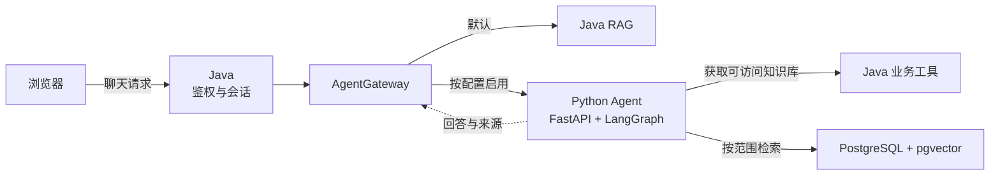

# Ragent · 企业知识库 Agent

**Java 后端与 Python Agent 运行时改造**

基于开源 Ragent，把知识库问答接入独立的 Python Agent 服务。Java 继续负责鉴权、会话持久化和业务工具授权，通过 `AgentGateway` 切换运行时，前端沿用原有的 SSE 聊天接口。

[架构与切换配置](docs/architecture/java-python-agent-runtime.md) · [接口契约](docs/contracts/agent-service-v1.openapi.yaml) · [Java 接入源码](bootstrap/src/main/java/com/nageoffer/ai/ragent/agent/python/PythonAgentGateway.java) · [回归验证](agent-service/evals/README.md)

`Spring Boot` · `FastAPI` · `LangGraph` · `PostgreSQL / pgvector` · `SSE`

## 一次问答怎么走

用户查询企业知识时，Java 确认身份并签发短期委托令牌。Python 通过 Java 工具获取可访问的知识库，再检索 pgvector，生成带来源的回答。Java 将增量和终止事件转回前端，并保存会话结果。

## 我的改造

| 改造点 | 实现 | 源码 |
| --- | --- | --- |
| 兼容原有聊天接口 | 在 `/rag/v3/chat` 后接入 Python，映射 SSE 增量和终止事件，并把取消请求传给对应的 Python Run。 | [SSE 适配器](bootstrap/src/main/java/com/nageoffer/ai/ragent/agent/python/PythonAgentGateway.java) |
| 限定知识库检索范围 | Java 校验委托身份及可访问的知识库。Python 依据返回的范围检索向量，并把引用带回回答。 | [业务工具契约](docs/contracts/business-tools-v1.openapi.yaml) · [检索实现](agent-service/src/ragent_agent/rag/retriever.py) |
| 处理运行中断和审批恢复 | 运行记录与 LangGraph 检查点分开持久化。重启时标记中断的运行，等待审批的任务可凭新令牌恢复。 | [运行记录](agent-service/src/ragent_agent/runtime/store.py) · [检查点](agent-service/src/ragent_agent/runtime/checkpoint.py) |

## 验证与运行

- **接口行为**。[Java SSE 契约测试](bootstrap/src/test/java/com/nageoffer/ai/ragent/agent/python/PythonAgentGatewayContractTest.java)覆盖事件转发、取消和会话写入路径。
- **检索与引用**。[Python 检索测试](agent-service/tests/test_rag_retrieval.py)覆盖知识库范围、租户过滤条件和引用构建。[问答回归样例](agent-service/evals/README.md)提供预期证据和评分口径。
- **运行方式**。默认使用 Java RAG。Python 知识库问答和文本入库需分别启用。启用条件、异常行为和回退步骤见[运行时说明](docs/architecture/java-python-agent-runtime.md)。

## 上游与许可

本仓库基于开源 [nageoffer/ragent](https://github.com/nageoffer/ragent)。本分支改写了首页说明，以展示 Java / Python 运行时接入的改造内容。原项目的版权声明和 [Apache License 2.0](LICENSE) 保留在源码中。
